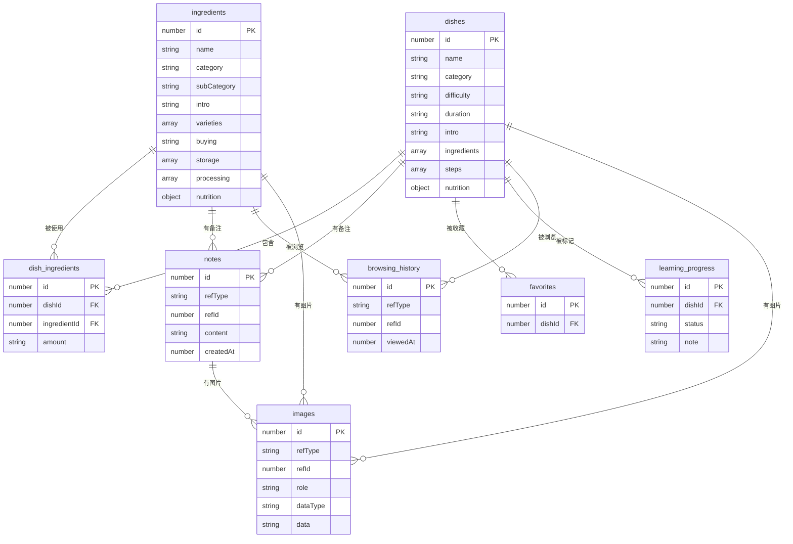
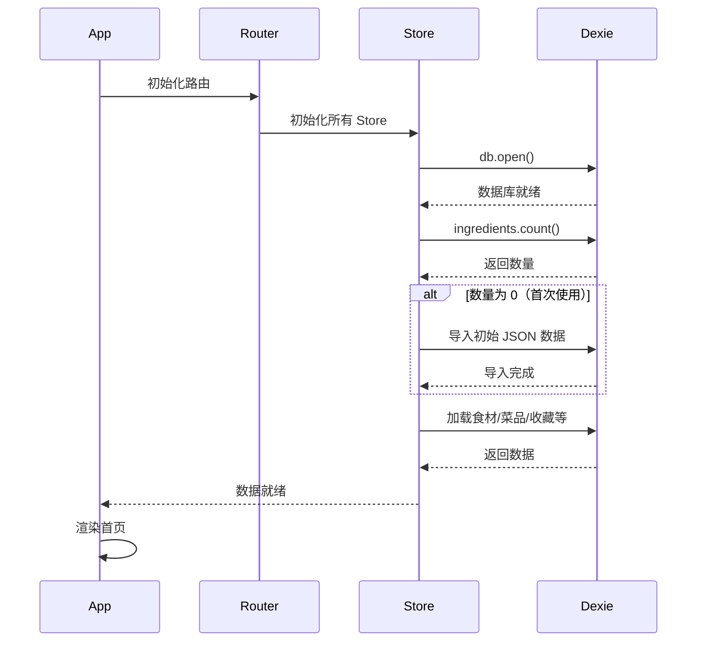
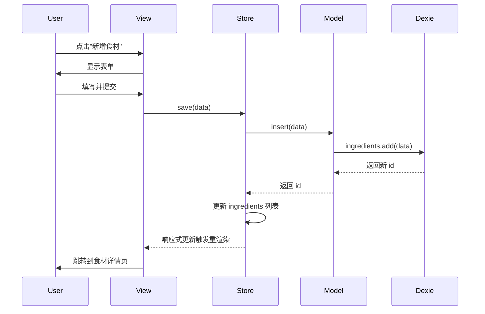
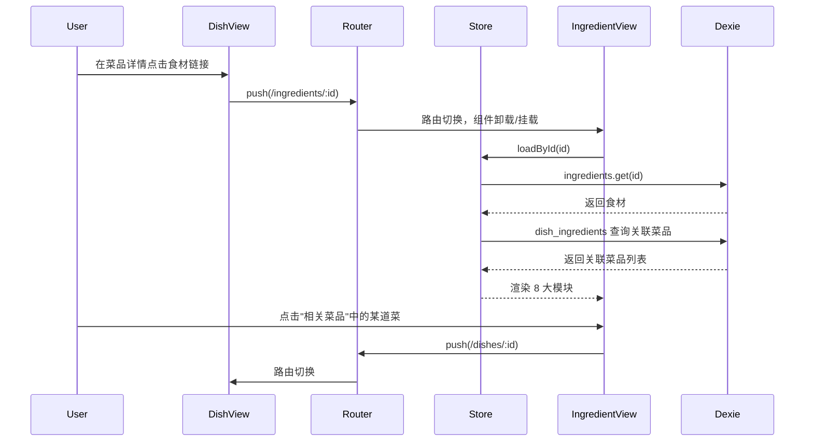
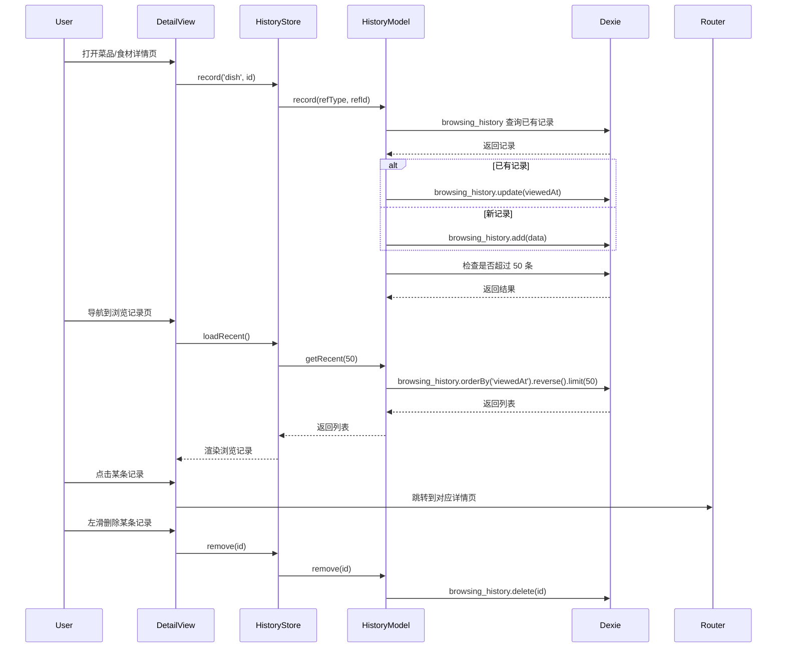
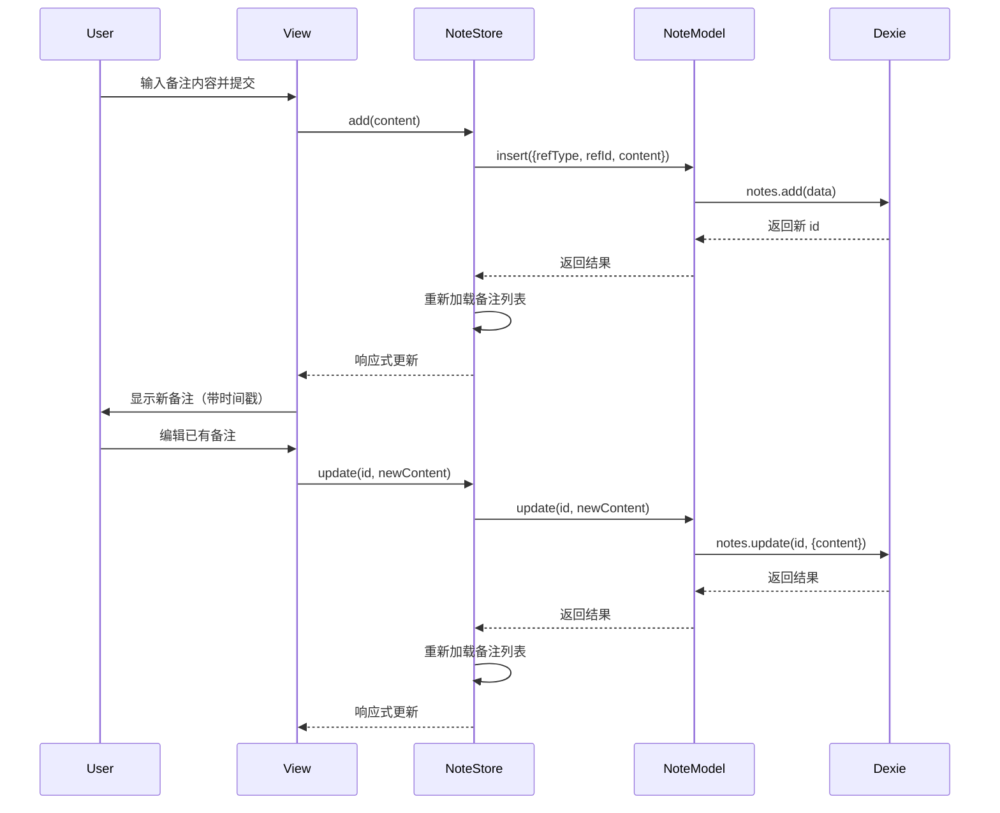
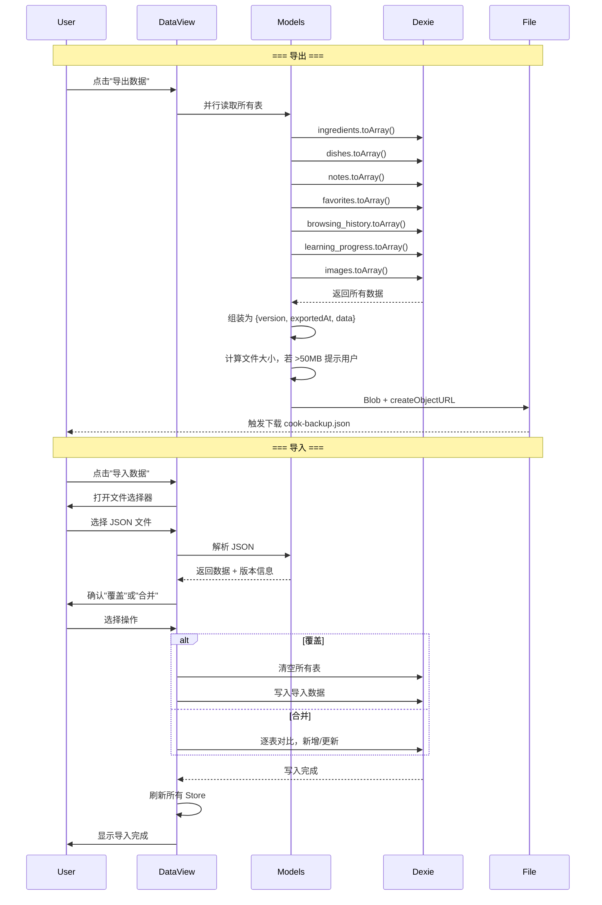
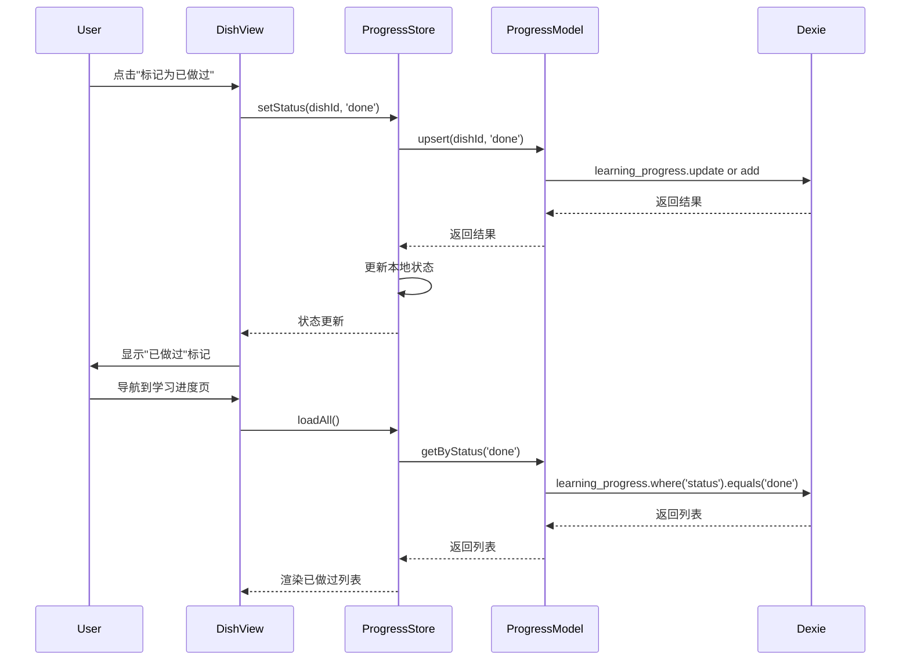
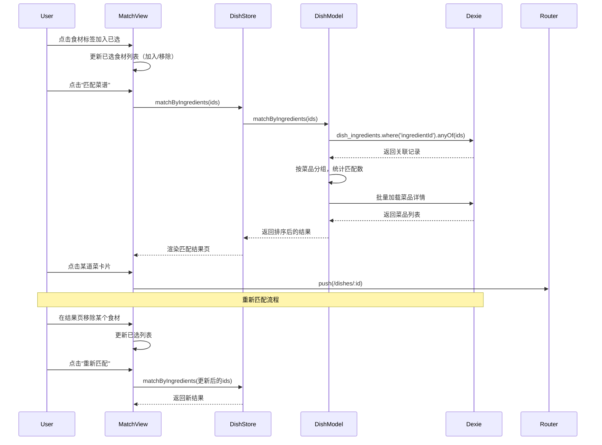
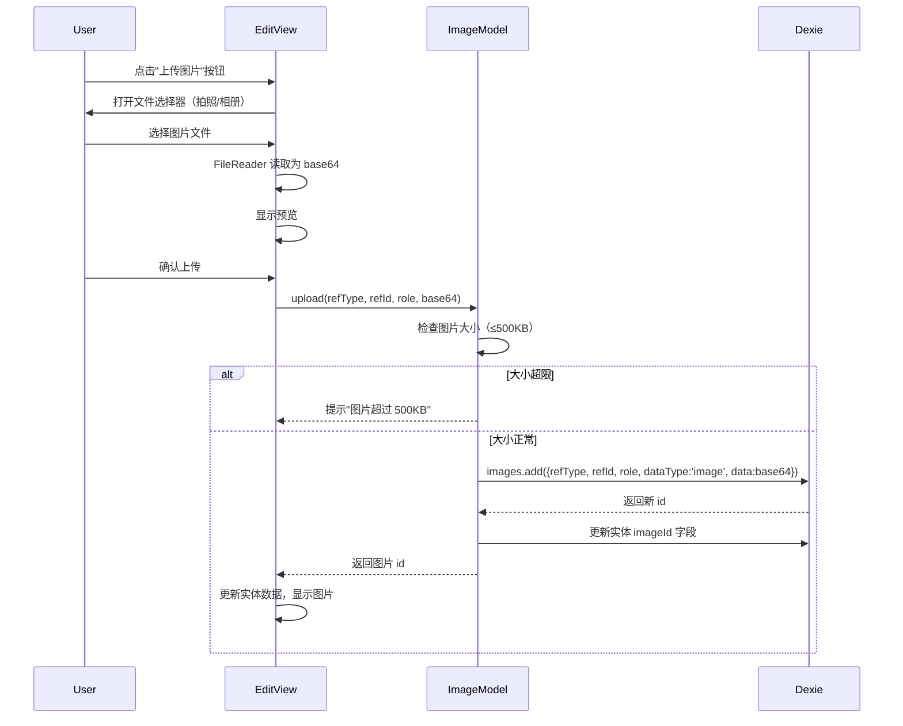

# 家常菜入门指南 — 设计文档

> 版本：v1.6  
> 日期：2026-10-31  
> 状态：设计完成，待开发  
> 更新：v1.6 新增图片与视频功能——images 表存储图片(base64)，视频用外部 URL  
> 说明：本文档描述技术实现方案（"怎么做"），用户需求见 [需求文档](../需求/需求文档.md)

---

## 一、技术选型

### 1.1 技术栈

| 层 | 技术 | 说明 |
|----|------|------|
| 框架 | Vue 3 + Vite | 组合式 API，Vite 快速构建 |
| 路由 | Vue Router 4（Hash 模式） | 单页应用路由管理 |
| 本地存储 | IndexedDB（封装 Dexie.js） | 浏览器原生 NoSQL，容量大，支持结构化查询 |
| PWA | vite-plugin-pwa | 支持安装为手机 App、离线访问 |
| UI 风格 | 自定义 CSS | 清新简约风，无重型 UI 框架依赖 |
| 构建 | Vite | 开发热更新 + 生产构建 |
| 部署 | GitHub Pages | 纯静态托管，免费公网 URL，无需服务器 |

### 1.2 三方库清单

| 库 | 版本 | 安装方式 | 用途 |
|----|------|----------|------|
| Vue 3 | ^3.4 | npm | 前端框架 |
| Vue Router | ^4 | npm | 路由管理 |
| Vite | ^5 | npm | 构建工具 |
| Dexie.js | ^4 | npm | IndexedDB 封装 |
| vite-plugin-pwa | ^0.20 | npm | PWA 支持（离线、安装到桌面） |

### 1.3 技术选型理由

**为什么选 Vue 3 而不是 React？**
- 模板语法直观，适合个人项目快速开发
- 组合式 API 代码组织清晰
- 生态成熟，文档丰富

**为什么选 IndexedDB 而不是 localStorage？**
- 容量大（几百MB+ vs 5MB），适合 100+ 食材/菜品的结构化数据
- 支持索引和查询，性能更好
- Dexie.js 封装后开发简单，与直接用 localStorage 复杂度相当

**为什么不用后端服务器？**
- 个人低频使用，不需要跨设备实时同步
- 数据量小（约 300-500KB），IndexedDB 完全够用
- 零服务器 = 零维护成本
- 通过导出/导入 JSON 实现手动同步

**为什么用 GitHub Pages 而不是内网穿透？**
- GitHub Pages 免费、稳定、无需电脑常开
- 自带公网 URL，手机随身用
- 零运维，自动部署

---

## 二、架构设计

### 2.1 整体架构

```
┌──────────────────────────────────────┐
│            GitHub Pages              │
│    （纯静态托管，公网 URL）           │
│                                        │
│  ┌────────────────────────────────┐  │
│  │     Vue 3 SPA（构建后的静态文件）  │  │
│  │                                │  │
│  │  ┌──────────┐  ┌──────────┐   │  │
│  │  │  路由层   │  │  状态层   │   │  │
│  │  │ (Hash)   │  │ (Pinia)  │   │  │
│  │  └────┬─────┘  └────┬─────┘   │  │
│  │       │              │          │  │
│  │  ┌────▼──────────────▼────┐    │  │
│  │  │      页面组件 (Views)    │    │  │
│  │  │   食材/菜品/收藏/清单...  │    │  │
│  │  └────┬──────────────┬────┘    │  │
│  │       │              │          │  │
│  │  ┌────▼────┐    ┌────▼────┐    │  │
│  │  │ 共享组件  │    │ 数据层   │    │  │
│  │  │ Components│   │ (Dexie) │    │  │
│  │  └─────────┘    └────┬────┘    │  │
│  └──────────────────────┼────────┘  │
│                         │            │
│                    ┌────▼─────┐      │
│                    │ IndexedDB │      │
│                    │  (本地)   │      │
│                    └──────────┘      │
└──────────────────────────────────────┘
```

### 2.2 路由方案

**使用 Hash 路由**（`createWebHashHistory`）

原因：GitHub Pages 是纯静态托管，不支持服务端路由回退。使用 `createWebHistory()` 会导致刷新页面 404。

```javascript
import { createRouter, createWebHashHistory } from 'vue-router'

const routes = [
  { path: '/', component: Home },
  { path: '/ingredients', component: IngredientList },
  { path: '/ingredients/:id', component: IngredientDetail },
  { path: '/dishes', component: DishList },
  { path: '/dishes/:id', component: DishDetail },
  { path: '/favorites', component: Favorites },
  { path: '/shopping-list', component: ShoppingList },
  { path: '/progress', component: LearningProgress },
  { path: '/settings', component: Settings },
]

const router = createRouter({
  history: createWebHashHistory(),
  routes,
})
```

URL 示例：`https://user.github.io/cook/#/ingredients/3`

### 2.3 状态管理

使用 Pinia 进行状态管理：

| Store | 职责 |
|-------|------|
| `useIngredientStore` | 食材列表、分类筛选、搜索 |
| `useDishStore` | 菜品列表、分类筛选、搜索、匹配 |
| `useFavoriteStore` | 收藏管理 |
| `useHistoryStore` | 浏览记录管理 |
| `useProgressStore` | 学习进度管理 |
| `useNoteStore` | 个人备注 |

### 2.4 页面结构

| 页面 | 路由 | 说明 |
|------|------|------|
| 首页 | `/` | 导航 + 快捷入口 + 学习进度概览 |
| 食材库 | `/ingredients` | 分类筛选 + 列表 + 搜索 |
| 食材详情 | `/ingredients/:id` | 8 大信息模块 |
| 菜品库 | `/dishes` | 分类+难度筛选 + 列表 + 搜索 |
| 菜品详情 | `/dishes/:id` | 菜品完整信息 + 备注 |
| 选菜匹配 | `/match` | 食材标签云 + 已选食材 + 匹配按钮 |
| 匹配结果 | `/match-results` | 按匹配度排序的菜品列表 |
| 个人中心 | `/profile` | 收藏 + 浏览记录 + 学习进度 + 设置入口 |
| 收藏 | `/favorites` | 收藏的菜品列表 |
| 浏览记录 | `/history` | 最近浏览的菜品/食材列表 |
| 学习进度 | `/progress` | 已做/想做列表 + 备注 |
| 设置 | `/settings` | 版本管理 + 数据管理 |

### 2.5 组件分层

```
src/
├── assets/           # 全局样式、图片
├── components/       # 共享组件
│   ├── NavBar.vue       # 顶部导航
│   ├── BottomNav.vue     # 手机底部导航（4项）
│   ├── IngredientCard.vue
│   ├── DishCard.vue
│   ├── NutritionTable.vue
│   ├── NoteList.vue      # 备注列表
│   ├── NoteInput.vue     # 备注输入
│   ├── ConfirmDialog.vue # 确认弹窗
│   └── HistoryItem.vue   # 浏览记录条目
├── views/            # 页面组件
│   ├── Home.vue
│   ├── IngredientList.vue
│   ├── IngredientDetail.vue
│   ├── DishList.vue
│   ├── DishDetail.vue
│   ├── Match.vue           # 选菜匹配
│   ├── MatchResults.vue    # 匹配结果
│   ├── Profile.vue         # 个人中心
│   ├── Favorites.vue
│   ├── History.vue         # 浏览记录
│   ├── LearningProgress.vue
│   └── Settings.vue        # 设置（版本管理 + 数据管理）
├── router/           # 路由配置
├── stores/           # Pinia 状态管理
└── db/               # Dexie 数据层封装
    ├── database.js   # 数据库定义
    ├── ingredientModel.js
    ├── dishModel.js
    └── noteModel.js
```

### 2.6 原型图设计

完整的可交互原型图见 [原型图](./原型图/index.html)（浏览器打开即可查看）。

原型图包含以下 9 个页面，每个页面同时展示桌面端和移动端布局：

| 页面 | 桌面端 | 移动端 |
|------|--------|--------|
| 首页 | 顶部导航 + 搜索 + 6 入口卡片 + 学习进度 | 底部导航 + 搜索 + 2列网格入口 |
| 食材库 | 分类标签 + 搜索 + 卡片网格 + 分页 | 分类标签(横滑) + 列表 + 加载更多 |
| 食材详情 | 面包屑 + 8 模块卡片(双列) | 面包屑 + 8 模块卡片(堆叠) |
| 菜品库 | 分类/难度标签 + 搜索 + 卡片网格 + 分页 | 分类/难度标签 + 列表 + 加载更多 |
| 菜品详情 | 面包屑 + 食材清单 + 步骤 + 营养 + 备注 | 面包屑 + 食材清单 + 步骤 + 营养 + 备注 |
| 选菜匹配 | 已选食材 + 分类标签云 + 匹配按钮 | 已选食材 + 分类标签云 + 匹配按钮 |
| 匹配结果 | 已选标签 + 匹配度排序 + 菜品卡片 | 已选标签 + 匹配度排序 + 列表 |
| 个人中心 | 收藏 + 浏览记录 + 学习进度 + 设置入口 | 收藏 + 浏览记录 + 学习进度 + 设置入口 |
| 收藏 | 顶部导航 + 卡片网格 | 底部导航 + 列表 |
| 浏览记录 | 顶部导航 + 记录列表 | 底部导航 + 记录列表 |
| 学习进度 | 双列(已做/想做) | 标签切换 + 列表 |
| 设置 | 版本管理 + 数据管理 | 版本管理 + 数据管理 |

### 2.7 分页导航设计

食材和菜品各有 100+ 条数据，列表页需要分页加载。

#### 分页策略

| 端 | 策略 | 每页条数 | 说明 |
|----|------|----------|------|
| 桌面端 | 传统分页 | 12 条 | "1 2 3 ... 10" 数字翻页 |
| 移动端 | 加载更多 | 10 条 | 列表底部"加载更多"按钮 |

**选择理由：**
- 桌面端有空间显示分页器，传统翻页更高效
- 移动端分页器占用空间大，"加载更多"更简洁，符合移动端浏览习惯

#### 桌面端分页器设计

```
┌─────────────────────────────────────────┐
│  [上一页]  1  2  3  4  5  ...  10  [下一页] │
└─────────────────────────────────────────┘
```

- 当前页高亮（橙色）
- 上一页/下一页按钮
- 页码过多时显示 "..." 省略
- 页码数量根据总页数动态计算

#### 移动端加载更多

```
┌─────────────────────────────────────────┐
│  [食材1]                                  │
│  [食材2]                                  │
│  [食材3]                                  │
│  ...                                      │
│  [食材10]                                 │
│  ──────────────────────────────────────── │
│       [ 加载更多 ]                          │
└─────────────────────────────────────────┘
```

- 已全部加载时按钮变为"没有更多了"（禁用状态）
- 加载中显示"加载中..."

#### 筛选与分页的关系

- 切换分类/难度筛选时，回到第 1 页
- 搜索时，回到第 1 页
- 筛选 + 搜索同时使用时，取交集结果

#### 多维度标签筛选

菜品列表支持按 `tags` 各维度筛选，筛选器布局：

**桌面端：**
```
[全部] [凉菜] [热炒] [汤羹] [主食] [甜点]        ← 主分类（单选）
[入门] [进阶] [挑战]                              ← 难度（单选）
────────────────────────────────────────────────
烹饪方式： [蒸] [煮] [炒] [炖] [烤] [炸]...     ← 烹饪方式（多选）
荤素场景： [荤] [素] [下酒菜] [减脂餐]...        ← 荤素/场景（多选）
菜系地域： [家常] [东北] [川菜] [粤菜]...        ← 菜系/地域（多选）
用餐时段： [早餐] [午餐] [晚餐] [夜宵]           ← 用餐时段（多选）
自定义：  [输入标签...]                           ← 自定义标签（搜索）
```

**移动端：**
- 主分类 + 难度作为顶部标签栏（横向滑动）
- 其他维度折叠在"更多筛选"中，点击展开
- 已选标签以 chip 形式展示在筛选区顶部，可逐个移除

---

## 三、数据模型设计

### 3.1 表结构总览

| 表名 | 说明 |
|------|------|
| `ingredients` | 食材主表 |
| `dishes` | 菜品主表 |
| `dish_ingredients` | 菜品-食材关联表（含用量） |
| `favorites` | 用户收藏（菜品） |
| `browsing_history` | 浏览记录（菜品/食材） |
| `learning_progress` | 学习进度记录 |
| `notes` | 个人备注 |
| `images` | 图片存储（base64，关联食材/菜品/步骤/备注） |

### 3.2 ingredients 表字段设计

| 字段 | 类型 | 说明 |
|------|------|------|
| id | number | 主键 |
| name | string | 食材名称（如"西红柿"） |
| imageId | number | 食材主图 ID（关联 images 表，可选） |
| category | string | 大分类（蔬菜/肉禽/海鲜水产/蛋奶/豆类/冻品/主食/调味项/干货） |
| subCategory | string | 子分类（仅调味项使用：基础调味/香辛料/复合调味） |
| intro | string | ① 介绍：基本信息、营养价值、烹饪角色 |
| varieties | array<object> | ② 品种：`{ name, feature, usage }` 数组 |
| buying | string | ③ 购买/挑选：挑选要点、避坑提示、价格参考 |
| storage | array<object> | ④ 储存：`{ method, condition, shelfLife, notes }` 数组 |
| processing | array<object> | ⑤ 处理：`{ step, detail }` 数组 |
| nutrition | object | ⑦ 营养成分：`{ perUnit, calories, fat, protein, carbs, fiber, sodium, healthNotes }` |
| createdAt | number | 创建时间 |
| updatedAt | number | 更新时间 |

> 品种、储存、处理等使用结构化数组而非自由文本，便于前端按模块渲染卡片，也方便后续按条件筛选。

### 3.3 dishes 表字段设计

| 字段 | 类型 | 说明 |
|------|------|------|
| id | number | 主键 |
| name | string | 菜品名称 |
| category | string | 主分类（凉菜/热炒/汤羹/主食/甜点） |
| difficulty | string | 难度（入门/进阶/挑战） |
| duration | string | 预估时长（如"10分钟"） |
| intro | string | 简介 |
| imageId | number | 菜品主图 ID（关联 images 表，可选） |
| videoUrl | string | 菜品视频链接（外部 URL，可选） |
| tags | object | 多维度分类标签：`{ cooking: [], diet: [], cuisine: [], meal: [], custom: [] }` |
| ingredients | array<object> | 食材清单：`{ ingredientId, name, amount }` |
| steps | array<object> | 制作步骤：`{ order, desc, note, imageId, videoUrl }` |
| nutrition | object | 营养信息：`{ perUnit, calories, fat, protein, carbs, healthNotes }` |
| createdAt | number | 创建时间 |
| updatedAt | number | 更新时间 |

#### tags 字段结构与分类维度定义

`tags` 为结构化对象，每个维度是一个字符串数组，菜品可拥有多个标签：

```javascript
tags: {
  cooking: ["炒"],              // 烹饪方式
  diet: ["荤"],                 // 荤素/场景
  cuisine: ["家常"],             // 菜系/地域
  meal: ["午餐", "晚餐"],        // 用餐时段
  custom: ["下酒菜", "快手菜"]   // 自定义标签
}
```

**各维度可选值定义（前端常量）：**

| 维度 | 键名 | 可选值 |
|------|------|--------|
| 烹饪方式 | `cooking` | 蒸、煮、炒、卤、烤、炸、烘焙、煎、炖、焖、拌、焗 |
| 荤素/场景 | `diet` | 荤菜、素菜、下酒菜、宝宝辅食、减脂餐、低卡、高蛋白 |
| 菜系/地域 | `cuisine` | 家常、东北、山西、川菜、粤菜、湘菜、江浙、西北、西南 |
| 用餐时段 | `meal` | 早餐、午餐、晚餐、夜宵 |
| 自定义 | `custom` | 用户自由输入，无预设限制 |

> `category` 字段与 `tags.cooking` 维度独立：`category` 是主分类用于导航浏览，`tags` 用于多维度筛选和标签展示。

### 3.4 notes 表字段设计

| 字段 | 类型 | 说明 |
|------|------|------|
| id | number | 主键 |
| refType | string | 关联类型：`ingredient` / `dish` |
| refId | number | 关联的食材或菜品 ID |
| content | string | 备注内容 |
| createdAt | number | 创建时间 |
| updatedAt | number | 更新时间 |

> 备注为多条记录，每条可独立增删改。同一食材/菜品可有多个备注。

### 3.5 其他表字段

**favorites 表：**

| 字段 | 类型 | 说明 |
|------|------|------|
| id | number | 主键 |
| dishId | number | 关联菜品 ID |
| createdAt | number | 收藏时间 |

**browsing_history 表：**

| 字段 | 类型 | 说明 |
|------|------|------|
| id | number | 主键 |
| refType | string | 关联类型：`dish` / `ingredient` |
| refId | number | 关联的菜品或食材 ID |
| viewedAt | number | 浏览时间 |

> 每次浏览菜品/食材详情页时记录。同一菜品/食材重复浏览时更新时间而非新增。最多保留 50 条。

**learning_progress 表：**

| 字段 | 类型 | 说明 |
|------|------|------|
| id | number | 主键 |
| dishId | number | 关联菜品 ID |
| status | string | 状态：`done` / `want` |
| note | string | 做菜感受/改进 |
| updatedAt | number | 更新时间 |

**images 表：**

| 字段 | 类型 | 说明 |
|------|------|------|
| id | number | 主键 |
| refType | string | 关联类型：`ingredient` / `dish` / `step` / `note` |
| refId | number | 关联的实体 ID（食材/菜品/步骤/备注） |
| role | string | 图片角色：`main` / `step_image` / `note_image` |
| dataType | string | 数据类型：`image`（当前仅支持图片） |
| data | string | base64 图片数据（`data:image/png;base64,...`） |
| createdAt | number | 创建时间 |

> **图片存储策略：**
> - 图片以 base64 格式存入 IndexedDB，完全本地化
> - 实体字段只存 `imageId`（指向 images 表），不直接存 base64
> - 列表页不加载图片，详情页按需加载，保证性能
> - 导出 JSON 时 images 表随数据一起导出，图片不丢失
> - 视频不存文件，以 URL 字符串存于实体字段中

### 3.6 数据关系图（ER Diagram）



**关系说明：**

| 关系 | 说明 | 级联行为 |
|------|------|----------|
| ingredients → dish_ingredients | 一个食材被多道菜使用 | 删除食材时提示关联菜品数 |
| dishes → dish_ingredients | 一道菜包含多个食材 | 删除菜品时移除关联记录 |
| ingredients → notes | 一个食材可有多条备注 | 删除食材时备注一并删除 |
| dishes → notes | 一道菜可有多条备注 | 删除菜品时备注一并删除 |
| dishes → favorites | 一道菜可被收藏 | 取消收藏即删除记录 |
| dishes → learning_progress | 一道菜有学习状态 | 删除菜品时移除进度记录 |
| ingredients → browsing_history | 一个食材可被浏览多次 | 删除食材时移除浏览记录 |
| dishes → browsing_history | 一道菜可被浏览多次 | 删除菜品时移除浏览记录 |

### 3.7 类设计

#### 数据层（db/ — Dexie Models）

**database.js — 数据库定义**

```javascript
import Dexie from 'dexie'

export const db = new Dexie('cook')

db.version(1).stores({
  // 主键 ++id，二级索引
  ingredients: '++id, name, category, subCategory',
  dishes: '++id, name, category, difficulty',
  // 关联表
  dish_ingredients: '++id, dishId, ingredientId',
  // 用户数据
  favorites: '++id, dishId',
  browsing_history: '++id, refType, refId, viewedAt',
  learning_progress: '++id, dishId, status',
  notes: '++id, refType, refId',
  images: '++id, refType, refId, role',
})
```

**ingredientModel.js — 食材模型**

```javascript
export const ingredientModel = {
  // 查询
  getAll: () => db.ingredients.toArray(),
  getById: (id) => db.ingredients.get(id),
  getByCategory: (category) =>
    db.ingredients.where('category').equals(category).toArray(),
  search: (keyword) =>
    db.ingredients.where('name').anyOf(keyword).toArray(),

  // 写入
  insert: (data) => db.ingredients.add({ ...data, createdAt: Date.now() }),
  update: (id, data) =>
    db.ingredients.update(id, { ...data, updatedAt: Date.now() }),
  remove: (id) => db.ingredients.delete(id),

  // 关联查询
  getRelatedDishes: (ingredientId) =>
    db.dish_ingredients
      .where('ingredientId').equals(ingredientId)
      .toArray()
      .then(rels =>
        Promise.all(rels.map(r => db.dishes.get(r.dishId)))
      ),
}
```

**dishModel.js — 菜品模型**

```javascript
export const dishModel = {
  // 查询
  getAll: () => db.dishes.toArray(),
  getById: (id) => db.dishes.get(id),
  getByCategory: (category) =>
    db.dishes.where('category').equals(category).toArray(),
  getByDifficulty: (difficulty) =>
    db.dishes.where('difficulty').equals(difficulty).toArray(),
  search: (keyword) =>
    db.dishes.where('name').anyOf(keyword).toArray(),

  // 写入
  insert: (data) => db.dishes.add({ ...data, createdAt: Date.now() }),
  update: (id, data) =>
    db.dishes.update(id, { ...data, updatedAt: Date.now() }),
  remove: (id) => {
    // 级联删除：关联表、备注、收藏、学习进度
    return Promise.all([
      db.dish_ingredients.where('dishId').equals(id).delete(),
      db.notes.where('refId').equals(id).delete(),
      db.favorites.where('dishId').equals(id).delete(),
      db.learning_progress.where('dishId').equals(id).delete(),
      db.dishes.delete(id),
    ])
  },

  // 关联查询
  getRelatedIngredients: (dishId) =>
    db.dish_ingredients
      .where('dishId').equals(dishId)
      .toArray()
      .then(rels =>
        Promise.all(rels.map(r => db.ingredients.get(r.ingredientId)))
      ),
}
```

**noteModel.js — 备注模型**

```javascript
export const noteModel = {
  getByRef: (refType, refId) =>
    db.notes
      .where('refId').equals(refId)
      .and(db.notes.where('refType').equals(refType))
      .toArray()
      .then(notes =>
        notes.sort((a, b) => b.createdAt - a.createdAt)
      ),

  insert: (data) =>
    db.notes.add({ ...data, createdAt: Date.now(), updatedAt: Date.now() }),
  update: (id, content) =>
    db.notes.update(id, { content, updatedAt: Date.now() }),
  remove: (id) => db.notes.delete(id),
}
```

**browsingHistoryModel.js — 浏览记录模型**

```javascript
export const browsingHistoryModel = {
  // 记录浏览（同一 refType+refId 更新时间而非新增）
  async record(refType, refId) {
    const existing = await db.browsing_history
      .where('refId').equals(refId)
      .and(db.browsing_history.where('refType').equals(refType))
      .first()
    if (existing) {
      await db.browsing_history.update(existing.id, { viewedAt: Date.now() })
    } else {
      await db.browsing_history.add({ refType, refId, viewedAt: Date.now() })
    }
    // 限制最多 50 条
    const all = await db.browsing_history.orderBy('viewedAt').reverse().toArray()
    if (all.length > 50) {
      await db.browsing_history.bulkDelete(all.slice(50).map(r => r.id))
    }
  },

  // 查询
  getRecent: (limit = 50) =>
    db.browsing_history.orderBy('viewedAt').reverse().limit(limit).toArray(),

  // 删除
  remove: (id) => db.browsing_history.delete(id),
  clear: () => db.browsing_history.clear(),
}
```
```

#### 状态层（stores/ — Pinia）

```javascript
// useIngredientStore.js
export const useIngredientStore = defineStore('ingredient', {
  state: () => ({
    ingredients: [],
    currentIngredient: null,
    relatedDishes: [],
    filter: { category: '', keyword: '' },
  }),
  actions: {
    async loadAll() {
      this.ingredients = await ingredientModel.getAll()
    },
    async loadById(id) {
      this.currentIngredient = await ingredientModel.getById(id)
      this.relatedDishes = await ingredientModel.getRelatedDishes(id)
    },
    async save(data) {
      if (data.id) {
        await ingredientModel.update(data.id, data)
      } else {
        const id = await ingredientModel.insert(data)
        return id
      }
      await this.loadAll()
    },
    async remove(id) {
      await ingredientModel.remove(id)
      await this.loadAll()
    },
    setFilter(filter) {
      this.filter = filter
    },
  },
})
```

```javascript
// useNoteStore.js
export const useNoteStore = defineStore('note', {
  state: () => ({
    notes: [],
    currentRef: { type: '', id: null },
  }),
  actions: {
    async loadByRef(refType, refId) {
      this.currentRef = { type: refType, id: refId }
      this.notes = await noteModel.getByRef(refType, refId)
    },
    async add(content) {
      await noteModel.insert({
        refType: this.currentRef.type,
        refId: this.currentRef.id,
        content,
      })
      await this.loadByRef(this.currentRef.type, this.currentRef.id)
    },
    async update(id, content) {
      await noteModel.update(id, content)
      await this.loadByRef(this.currentRef.type, this.currentRef.id)
    },
    async remove(id) {
      await noteModel.remove(id)
      await this.loadByRef(this.currentRef.type, this.currentRef.id)
    },
  },
})
```

#### 组件层结构

```
views/
├── IngredientDetail.vue
│   ├── props: id (from route)
│   ├── composes: useIngredientStore, useNoteStore
│   ├── renders:
│   │   ├── NutritionTable.vue     (营养信息)
│   │   ├── NoteList.vue           (备注列表)
│   │   ├── NoteInput.vue          (备注输入)
│   │   └── RelatedDishes.vue      (相关菜品)
│   └── watch: route.params.id → loadById()
│
├── DishDetail.vue
│   ├── props: id (from route)
│   ├── composes: useDishStore, useNoteStore
│   ├── renders:
│   │   ├── IngredientList.vue     (食材清单)
│   │   ├── StepList.vue            (制作步骤)
│   │   ├── NutritionTable.vue      (营养信息)
│   │   ├── NoteList.vue            (备注列表)
│   │   └── NoteInput.vue           (备注输入)
│   └── watch: route.params.id → loadById()
```

### 3.8 数据流转设计

#### 3.8.1 应用初始化



#### 3.8.2 CRUD 数据流转



#### 3.8.3 双向关联跳转



#### 3.8.4 浏览记录



#### 3.8.5 个人备注



#### 3.8.6 数据导出导入



#### 3.8.7 学习进度标记



#### 3.8.8 食材匹配推荐

**匹配算法：**

```javascript
// dishModel.js — 新增方法
async function matchByIngredients(ingredientIds) {
  if (!ingredientIds || ingredientIds.length === 0) return []

  // 1. 找出所有使用了任一选中食材的菜品关联记录
  const allRels = await db.dish_ingredients
    .where('ingredientId')
    .anyOf(ingredientIds)
    .toArray()

  // 2. 按菜品分组，统计每个菜品匹配了几个食材
  const dishMatchMap = new Map()
  for (const rel of allRels) {
    if (!dishMatchMap.has(rel.dishId)) {
      dishMatchMap.set(rel.dishId, {
        dishId: rel.dishId,
        matchedCount: 0,
        matchedIngredientIds: [],
      })
    }
    const entry = dishMatchMap.get(rel.dishId)
    entry.matchedCount++
    entry.matchedIngredientIds.push(rel.ingredientId)
  }

  // 3. 按匹配数降序排列
  const sorted = [...dishMatchMap.values()]
    .sort((a, b) => b.matchedCount - a.matchedCount)

  // 4. 批量加载菜品详情
  const results = await Promise.all(
    sorted.map(item =>
      db.dishes.get(item.dishId).then(dish => ({
        ...dish,
        matchInfo: {
          matchedCount: item.matchedCount,
          totalSelected: ingredientIds.length,
          matchedIngredientIds: item.matchedIngredientIds,
        },
      }))
    )
  )

  return results
}
```

**数据流转：**



**匹配度标识：**

| 匹配度 | 显示 | 说明 |
|--------|------|------|
| 100% | "✅ 完美匹配 (5/5)" | 使用了全部已选食材 |
| 80%+ | "用了 4/5 个食材" | 大部分食材匹配 |
| 50%+ | "用了 3/5 个食材" | 部分食材匹配 |
| <50% | "用了 2/5 个食材" | 少部分食材匹配 |

> 默认展示所有匹配结果（至少匹配 1 个），按匹配度降序排列。用户可筛选"仅看完美匹配"。

#### 3.8.9 图片上传



**图片加载策略：**

| 场景 | 策略 |
|------|------|
| 列表页卡片 | 显示缩略图（如无图片则显示 emoji 占位） |
| 详情页顶部 | 加载主图（按需加载，不阻塞页面） |
| 步骤区域 | 滚动到该步骤时加载步骤图 |
| 备注图片 | 展开备注时加载图片 |

**图片删除：**

- 编辑实体时可删除图片（同时删除 images 表中的记录）
- 删除实体时关联图片一并删除（级联）

---

### 3.9 数据版本同步机制

**问题**：数据存在两个位置——线上的 `import-data.json`（初始数据）和各设备浏览器的 IndexedDB（运行时数据）。早期实现只在「数据库为空」时导入，导致数据更新后，**已访问过的设备永远看不到新版**。

**方案**：给 `import-data.json` 加 `dataVersion` 字段，应用启动时对比版本，实现「基础数据刷新 + 个人数据保留」的增量同步。

#### 两类数据

| 类型 | 表 | 更新时 |
|------|-----|--------|
| 基础数据 | `ingredients` / `dishes` / `dish_ingredients` | ✅ 清空重写 |
| 个人数据 | `notes` / `favorites` / `browsing_history` / `learning_progress` / `images` | 🔒 保留 |

#### 同步流程

```
应用启动
   │
   ▼
fetch import-data.json
   │
   ├─ 本地 ingredients 为空 ──→ 全量导入基础数据
   │
   ├─ 远端 dataVersion ≠ 本地已记录版本 ──→ 清空重写基础数据 + 清理孤儿个人数据
   │
   └─ 版本相同 ──→ 跳过，用现有数据
   │
   ▼
记录版本号，挂载应用
```

#### 版本记录

| 项 | 位置 |
|----|------|
| 远端版本 | `import-data.json` 的 `dataVersion`，格式 `YYYYMMDDNN`（日期 + 当日序号，如 `2026110401`） |
| 本地版本 | `localStorage['cook-data-version']` |

#### 孤儿清理

更新基础数据后，清理指向已删除实体的个人数据：

- `favorites` / `learning_progress`：`dishId` 不在新 `dishes` 中
- `notes` / `browsing_history`：`refId` 不在对应类型实体中

#### 生成端写入

版本号格式为 `YYYYMMDDNN`：8 位日期 + 2 位当日序号。同一天内多次生成数据，序号自动 +1（`…01 → …02`）；跨到新的一天从 `01` 重新开始。

| 脚本 | 写入 |
|------|------|
| `ai-gen/lib/data-version.js` | 版本号工具：`nextDataVersion(当前值)` 推导下一个版本号 |
| `generate-data.js` | `dataVersion = nextDataVersionForFile(数据文件)` |
| `merge-dishes.js` | `mainData.dataVersion = nextDataVersion(mainData.dataVersion)` |
| `node ai-gen/run.js version [--apply]` | 查看当前/下一个版本号；`--apply` 生成新版本号并写入 |

> 同步逻辑只判断「远端版本是否等于本地版本」，与版本号具体形式无关。旧的时间戳版本号会被自动识别为旧格式，重置为当天 `01`。

> 效果：数据更新后，所有设备**刷新页面即得新版**，个人数据（备注/收藏/历史/进度/图片）完整保留，无需手动清缓存。

---

## 四、兼容性策略

### 4.1 目标平台

| 平台 | 浏览器 | 支持程度 |
|------|--------|----------|
| 桌面 | Chrome / Edge | ✅ 完美 |
| 移动端 | Android Chrome | ✅ 完美 |
| 移动端 | iOS Safari | ❌ 不支持 |

> 所有目标平台均为 Chromium 内核，兼容性问题极少。

### 4.2 关键技术决策

| 决策 | 原因 |
|------|------|
| Hash 路由 | GitHub Pages 是纯静态托管，不支持服务端路由回退，刷新会 404 |
| 浏览器目标 | Chrome 80+ / Edge 80+ / Android Chrome，均为现代 Chromium |
| 触摸适配 | 按钮点击区域 ≥ 44×44px，移动端用 `@media (hover: none)` 区分触摸设备 |
| CSS 策略 | 避免使用实验性 CSS 特性，autoprefixer 处理必要前缀 |
| 移动端导航 | 底部导航栏（手指可达性好），非顶部导航 |

### 4.3 无需处理的兼容性问题

由于只支持 Chromium 内核，以下问题**不需要考虑**：

- ❌ Safari 特有的 CSS 前缀
- ❌ iOS PWA 安装配置（apple-touch-icon 等）
- ❌ iOS Service Worker 缓存限制
- ❌ iOS 输入框自动缩放
- ❌ Firefox 兼容性

### 4.4 移动端适配细节

| 项 | 要求 |
|----|------|
| 触摸目标 | 按钮/链接最小 44×44px |
| 安全区域 | 适配 Android 底部安全区（`env(safe-area-inset-bottom)`） |
| 点击高亮 | 禁用（`-webkit-tap-highlight-color: transparent`） |
| 滚动惯性 | 支持（`-webkit-overflow-scrolling: touch`） |
| 字号 | 正文 ≥ 14px，避免过小 |

### 4.5 浏览器兼容目标

Vite 构建配置 `browserslist`：

```json
{
  "browserslist": [
    "Chrome >= 80",
    "Edge >= 80",
    "Android Chrome >= 80"
  ]
}
```

---

## 五、部署方案

### 5.1 构建与托管

| 环节 | 方案 |
|------|------|
| 构建产物 | `npm run build` 生成纯静态文件（HTML/CSS/JS） |
| 托管 | GitHub Pages（免费公网 URL，无需服务器） |
| 手机访问 | 浏览器打开 URL → 安装为 PWA |
| 电脑访问 | 浏览器打开 URL |
| 数据存储 | IndexedDB（浏览器本地，各设备独立） |
| 数据同步 | 手动导出 JSON → 传到另一设备 → 导入 |

### 5.2 GitHub Pages 配置

1. 创建 GitHub 仓库（如 `cook`）
2. 推送代码
3. 仓库 Settings → Pages → Source: `main` branch, `/docs` folder
4. 等待自动部署，获取公网 URL：`https://<用户名>.github.io/cook/`

### 5.3 PWA 配置

使用 `vite-plugin-pwa` 自动生成：

- `manifest.json`：应用名称、图标、主题色
- Service Worker：缓存静态资源，支持离线访问
- 安装提示：Android Chrome 自动弹出"添加到主屏幕"

**图标要求：**
- 192×192 px（PWA 最低要求）
- 512×512 px（启动画面）
- 透明背景 PNG

### 5.4 数据导出导入实现

**导出：**
- 遍历所有 Dexie 表，组装为 JSON 对象
- 通过 `Blob` + `URL.createObjectURL` 触发浏览器下载
- 文件名：`cook-backup-YYYY-MM-DD.json`

**导入：**
- 文件选择器选择 JSON 文件
- 解析后逐表写入 Dexie
- 导入前确认：覆盖 or 合并

---

## 六、非功能性需求

| 维度 | 要求 |
|------|------|
| 性能 | 首屏加载 < 2s，列表切换流畅 |
| 兼容性 | Chrome / Edge（桌面端）+ Chrome（Android 移动端） |
| 离线支持 | PWA 离线可用，基本功能不依赖网络 |
| 数据安全 | 数据存本地浏览器 IndexedDB，支持一键导出 JSON 备份 |
| 可维护性 | 模块化代码结构，清晰注释 |
| 响应式 | 桌面端为主，移动端可正常浏览 |
| 安装体验 | 可作为 PWA 安装到 Android 桌面，支持离线打开 |

---

## 七、界面风格规范

### 7.1 色彩体系

**设计原则：精简色系，同一色系不同明度为主，仅保留语义色用于分类标识。**

| 角色 | 色值 | 用途 |
|------|------|------|
| 主色 | `#FF6B35` | 按钮、链接、导航高亮、进阶难度标签 |
| 主色-浅 | `#FFF0EB` | 标签背景、hover 态背景、入口卡片图标背景 |
| 主色-深 | `#E55A2B` | 按钮按压态、hover 加深 |
| 辅色 | `#2D9D78` | 入门难度、成功状态、"已做过"标记、收藏 |
| 辅色-浅 | `#E8F5F0` | 辅色相关标签背景、入口卡片图标背景 |
| 危险 | `#E74C3C` | 挑战难度、删除按钮、错误提示 |
| 危险-浅 | `#FDECEA` | 危险标签背景、入口卡片图标背景 |
| 背景 | `#F7F7F7` | 页面背景 |
| 卡片 | `#FFFFFF` | 卡片、输入框背景 |
| 文字-主 | `#333333` | 标题、正文 |
| 文字-次 | `#888888` | 次要信息、描述 |
| 文字-弱 | `#BBBBBB` | 占位符、禁用 |
| 边框 | `#E8E8E8` | 卡片边框、分割线 |

**色彩分配规则：**

| 场景 | 使用颜色 | 说明 |
|------|----------|------|
| 操作类（按钮/链接/导航） | 主色（橙） | 统一使用橙色系 |
| 入门/成功/收藏 | 辅色（绿） | 语义色，仅用于正面状态 |
| 挑战/危险/删除 | 危险（红） | 语义色，仅用于负面状态 |
| 进阶难度 | 主色（橙） | 使用主色而非独立色系 |
| 中性信息 | 灰色系 | 文字、边框、背景 |

> 总色彩数：3 个语义色（橙/绿/红）+ 4 个中性色（白/灰阶）= **7 色**，避免色彩过于丰富。

### 7.2 字体规范

| 层级 | 字号 | 字重 | 行高 | 用途 |
|------|------|------|------|------|
| H1 | 24px | 700 | 32px | 页面标题 |
| H2 | 20px | 600 | 28px | 区块标题 |
| H3 | 16px | 600 | 24px | 卡片标题、模块标题 |
| 正文 | 14px | 400 | 22px | 正文内容 |
| 辅助 | 13px | 400 | 20px | 标签、次要信息 |
| 说明 | 12px | 400 | 18px | 时间戳、提示文字 |

### 7.3 间距体系

采用 4px 基准间距系统：

| 变量 | 值 | 用途 |
|------|-----|------|
| `--space-1` | 4px | 图标与文字间距 |
| `--space-2` | 8px | 紧凑元素间距 |
| `--space-3` | 12px | 卡片内元素间距 |
| `--space-4` | 16px | 卡片内边距、元素间距 |
| `--space-5` | 20px | 页面边距 |
| `--space-6` | 24px | 区块间距 |
| `--space-8` | 32px | 大区块间距 |

### 7.4 圆角与阴影

| 元素 | 圆角 | 阴影 |
|------|------|------|
| 卡片 | 12px | `0 2px 8px rgba(0,0,0,0.06)` |
| 按钮 | 8px | 无（hover 时 `0 2px 6px rgba(255,107,53,0.3)`） |
| 输入框 | 8px | 无 |
| 标签 | 4px（或全圆） | 无 |
| 弹窗 | 16px | `0 8px 32px rgba(0,0,0,0.15)` |

### 7.5 组件样式

**按钮：**

| 类型 | 样式 |
|------|------|
| 主按钮 | 主色背景 + 白字，点击有按压反馈 |
| 次按钮 | 白底 + 边框 + 主色文字 |
| 危险按钮 | 危险色背景 + 白字 |
| 文字按钮 | 无背景无边框，主色文字 |
| 禁用态 | 背景 `#F5F5F5` + 文字 `#BBBBBB` |

**卡片：**

| 属性 | 值 |
|------|-----|
| 背景 | `#FFFFFF` |
| 圆角 | 12px |
| 内边距 | 16px |
| 阴影 | `0 2px 8px rgba(0,0,0,0.06)` |
| hover | 阴影加深 `0 4px 12px rgba(0,0,0,0.1)` |

**标签：**

| 类型 | 样式 |
|------|------|
| 分类标签 | 主色-浅背景 + 主色文字 |
| 难度标签 | 辅色-浅背景 + 辅色文字（入门）/ 橙色背景 + 白字（进阶）/ 红色-浅 + 红字（挑战） |
| 数量标签 | 灰色背景 + 灰色文字 |

**输入框：**

| 属性 | 值 |
|------|-----|
| 背景 | `#FFFFFF` |
| 边框 | `1px solid #E8E8E8` |
| 圆角 | 8px |
| 内边距 | 10px 12px |
| 聚焦 | 边框变主色 `1px solid #FF6B35` |
| 高度 | 36px |

### 7.6 导航设计

**桌面端（顶部导航栏）：**

```
┌──────────────────────────────────────────────┐
│ 🍳 家常菜   [搜索框..............]  收藏 清单 进度 │
└──────────────────────────────────────────────┘
```

- 高度 56px，白底，底部 1px 边框
- 左侧 Logo + 名称
- 中间搜索框
- 右侧功能入口
- 当前页面入口高亮

**移动端（底部导航栏）：**

```
┌──────────────────────────────┐
│                               │
│         (页面内容)              │
│                               │
│  ┌───┐┌───┐┌───┐┌───┐       │
│  │首页│食材│菜品│我的│       │
│  └───┘└───┘└───┘└───┘       │
└──────────────────────────────┘
```

- 高度 56px + 底部安全区
- 白底，顶部 1px 边框
- 4 个图标 + 文字入口
- 当前页面高亮（主色）
- 固定在屏幕底部

**个人中心（"我的"）包含：**

| 入口 | 说明 |
|------|------|
| 收藏 | 收藏的菜品列表 |
| 浏览记录 | 最近浏览的菜品/食材 |
| 学习进度 | 已做过/想做列表 |
| 设置 | 版本管理、数据管理 |

### 7.7 图标风格

- 使用线性图标（stroke 而非 fill）
- 尺寸：24px（导航）、20px（卡片内）、16px（列表内）
- 颜色：跟随文字颜色或主色
- 来源：使用开源图标库（如 Lucide Icons）

### 7.8 动效

| 场景 | 动效 | 时长 |
|------|------|------|
| 页面切换 | 淡入淡出 | 0.2s |
| 卡片 hover | 阴影加深 + 轻微上移 | 0.2s ease |
| 按钮点击 | 按压缩放 0.97 | 0.1s |
| 列表加载 | 骨架屏闪烁 | 1.5s 循环 |
| 加载更多 | 旋转图标 | 持续 |

---

## 八、开发里程碑

| 阶段 | 内容 | 预估 |
|------|------|------|
| Phase 1 | 项目初始化、路由搭建、IndexedDB 封装、数据模型定义 | 基础框架 |
| Phase 2 | 食材模块（列表+详情+增删改） | 核心功能 |
| Phase 3 | 菜品模块（列表+详情+增删改） | 核心功能 |
| Phase 4 | 双向关联导航打通 | 核心功能 |
| Phase 5 | 收藏、浏览记录、学习进度、个人中心 | 扩展功能 |
| Phase 6 | 初始数据填充、视觉打磨、响应式优化 | 完善 |
| Phase 7 | PWA 配置 + GitHub Pages 部署 + 数据导出导入功能 | 上线 |

---

*文档结束 — 设计与需求已确认，可进入开发阶段*
